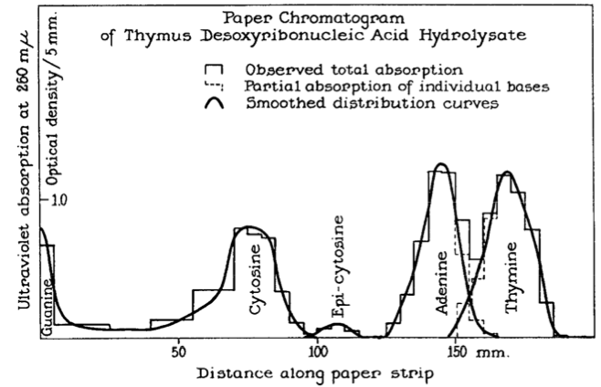
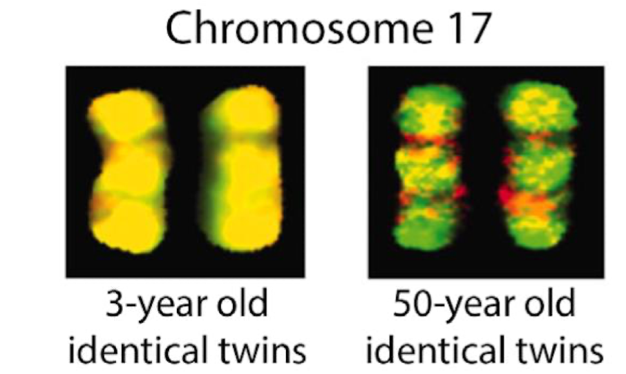

# MBI 3100A
## Epigenomics


---

# What is epigenetics?

* Originally coined to describe the effect of genetic mutations on pathways of cell differentiation (*epigenetic landscape*, Waddington, 1935).
  * `*Epi*-' is Latin for 'above'
* The modern definition of epigenetics is the study of molecular modifications that cause the same DNA sequence to have distinctly different functions.
* Genes are silenced by modifications known as **epigenetic marks**:
  * DNA methylation, histone modifications, and non-coding RNA

---

### Epigenetic marks
# DNA methylation

* The most commonly studied type of epigenetic mark
* Addition of a methyl group to a nucleotide to repress transcription.
  * Can target adenine or cytosine, but cytosine methylation is more common.
* 5-methylcytosine was first isolated in 1925 from *Mycobacterium tuberculosis* as a hypothetical determinent of pathogenesis.

<div style="display: flex; align-items: center; justify-content: space-around;">
<div style="flex: 1.2;">
  
</div>
<div style="flex: 1; font-size: 14pt; font-weight: 500;">
  Early observation of "epicytosine" from a paper chromatogram of DNA isolated from calf thymus (Hotchkiss, 1948).
</div>
</div>

---

### Epigenetic marks
# DNA methylation

* Cytosine methylation commonly occurs 
* There are about 28 million CpG sites in the human genome clustered into "islands"

* Strong inverse correlation with gene expression
  * Viewed as the key that "locks in" a chromatin state


<small>
Image source: https://commons.wikimedia.org/wiki/File:DNAme_landscape.svg
</small>

---

### Epigenetic marks
# Histone modifications

* The nucleosome is a basic functional unit of chromatin, consists of DNA wrapped around histones.
* Histone tails that project from nucleosomes are targeted for post-translational modification.
  * Including methylation, [acetylation](https://en.wikipedia.org/wiki/Histone_acetylation_and_deacetylation), phosphorylation, and ubiquination.
  * Modifies the positive charge of the histone, reshaping the negatively-charged DNA and creating enzyme recognition sites.
* Hundreds of modifications have been described, but most have unknown function.

---

### Epigenetic marks
# Histone code

* The [histone code](https://en.wikipedia.org/wiki/Histone_code) is a hypothesis that combinations of histone modifications may regulate DNA transcription.
* Thousands of combinations have been described, most unique to a single promoter.
  * Some patterns have been found in thousands of genes.


<small>
Image source: Based on Rodriguez-Paredes and Esteller (2011).  <a href="https://commons.wikimedia.org/wiki/File:Histone_modifications.svg">Wikimedia Commons</a> (CC-BY-SA 4.0).
</small>

---

### Epigenetic marks
# Non-coding RNA

* 95% of the human genome is transcribed at some point, but only 2% is protein-coding.
* Non-coding RNA (ncRNA) can:
  * Activate and repress transcription
  * Shape chromatin architecture by recruiting/interfering with epigenetic effectors.

---

# Environmental interactions

* In many cell types, epigenetic marks respond to environmental cues:
  * *e.g.*, malnutrition, drug exposure, smoking and stress.
* Cellular changes due to environmental factors are reflected as epigenetic changes.

<div style="display: flex; align-items: center; justify-content: space-around;">
  <div style="flex: 1;">
    
  </div>
  <div style="flex: 1; font-size: 14pt; font-weight: 500;">
  "Although monozygotic twins are epigenetically indistinguishable during the early years of life, older [...] twins exhibited remarkable differences..."<br/>
  Image source: Fraga <i>et al.</i> <a href="https://www.pnas.org/doi/abs/10.1073/pnas.0500398102">Proc Natl Acad Sci</a>.
  </div>
</div>

---

# Epigenetic differences can be associated with disease

* In first five years of human lifespan, the genome undergoes drastic hypermethylation that is concentrated in genes associated with development.
  * Leukocytes undergo major epigenome remodeling, possibly an immunological "window of opportunity".
* Epigenome-wide association studies (EWAS) have found associations between CpGs and breast cancer, chronic kidney disease, ischemic heart disease and diabetes.

<small>
Sources: Pia Campagna <i>et al.</i> (2021) <a href="https://link.springer.com/article/10.1186/s13148-021-01200-8">Clinical Epigenetics 13: 214</a>; Hillary <i>et al.</i> (2023) <a href="https://journals.plos.org/plosmedicine/article?id=10.1371/journal.pmed.1004247">PLOS Medicine 20(7): e1004247</a>.
</small>

---

# Methylation studies

* At a given nucleotide site, a cell is 0%, 50% or 100% methylated.
  * There are two copies of the DNA sequence in each cell (except sex chromosomes in males).
* A bulk methylation measurement averages these values across all cells in the sample.
  * Methylation levels can be highly tissue- and age-specific.

---

# Bisulfite sequencing

* Bisulfite converts cytosine residues to uracil, leaving 5-mC residues unaffected.
  * C and 5-mC residues can be distinguished at single-nucleotide resolution.

```seq
                        G G T C A G T G A mC G
bisulfite conversion          |            |  
                        G G T U A G T G A mC G
PCR amplification 
                        G G T T A G T G A  C G
```

---

# DNA methylation microarray

* Following bisulfite conversion, sample undergoes amplification and fragmentation.
* The [Inifinium MethylationEPIC](https://www.illumina.com/products/by-type/microarray-kits/infinium-methylation-epic.html) array covers 850K CpG sites in the human genome.
  * Each probe consists of a 50-mer attached to a bead that fluoresceses on binding.
  * Type I probes have methylated and unmethylated probe sequences per CpG.
  * Type II probes use only one sequence, occupying half as much space as a Type I.
  * More recent (2022) EPICv2 array covers ~930K CpG sites in the human genome.

---

# Methylation array workflow

1. Import raw IDAT (Intensity DATa) file
2. Probe and sample level filtering
  * *e.g.*, cross-reactivity: off-target hybridization of probes to polymorphisms or sex chromosomes.
3. Normalization: background correction
4. Visualization: PCA, batch effect screening, outlier removal.
5. Analysis: Identify differentially methylated probes / regions. Pathway and network analysis.

---

# Whole-genome bisulfite sequencing

* WGBS offers higher resolution but can be very expensive.
* Following bisulfite treatment, nucleic acids are tagged with unique sequences prior to amplification and NGS library construction.
  * Tagging provides a means of removing amplification bias.
* Sequencing enables direct measurement of methylation.
  * Can detect 5-mC at previously unknown sites.
  * Sufficient read depth can be difficult to attain.
